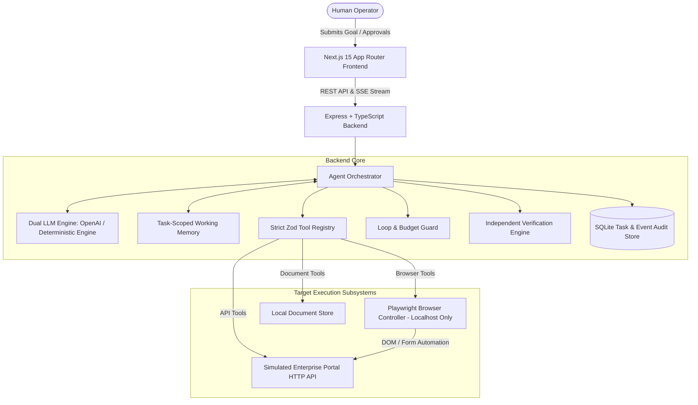

# TaskPilot AI — System Architecture

## 1. High-Level Architecture Overview

TaskPilot AI is an autonomous AI employee built as a modular TypeScript monorepo designed to operate in controlled enterprise environments. It bridges high-level, natural-language human intentions with reliable, verified, and audited systems execution.

---

## 2. Core Subsystems

### A. Agent Orchestrator & Bounded Execution Loop
The orchestrator drives a strictly bounded plan-act-observe cycle:
1. **Goal Ingestion & Validation**: Rejects empty inputs, assigns a deterministic task ID, sets initial status `queued`, and persists task metadata.
2. **Dynamic Decomposition**: Synthesizes a multi-step execution plan and isolates the immediate next subgoal.
3. **Budget & Timeout Enforcement**:
   - `MAX_STEPS`: Configurable maximum tool actions (default: 15).
   - `MAX_RETRIES_PER_ACTION`: Configurable retries for transient failures (default: 3).
   - `ACTION_TIMEOUT_MS`: Per-action timeout with `Promise.race` (default: 15,000ms).
   - `TASK_TOTAL_TIMEOUT_MS`: Overall wall-clock task ceiling (default: 120,000ms).
4. **Loop & Action Duplicate Detection**: Computes a deterministic hash `toolName:JSON.stringify(args)`. If the same signature repeats 3 consecutive times without progress, the loop guard halts the task with status `failed` and records a `loop_detected` event.

### B. Dual-Mode LLM Engine
- **OpenAI Tool Calling Provider**: Uses OpenAI's Responses / Function Calling API with structured schemas and temperature 0.1 for high determinism.
- **Autonomous Deterministic Engine**: Built-in zero-cost heuristic reasoning engine that performs step synthesis, subgoal tracking, observation analysis, duplicate detection, and error recovery out of the box without requiring paid API keys.

### C. Restricted Tool Registry & Security Allowlist
Every tool implements the `ToolDefinition` interface:
- **Zod Validation**: Arguments are parsed against strict schemas before execution; invalid calls fail immediately with descriptive errors.
- **Side Effect Classification**:
  - `read_only`: Search, inspection, document extraction, screenshots.
  - `consequential_write`: Financial ledger creation, database modification.
- **Human Approval Gate**: Consequential write tools automatically trigger an approval pause when `REQUIRE_APPROVAL_FOR_WRITES=true`, yielding status `awaiting_approval`.
- **Domain Restriction**: Browser automation is strictly restricted to `localhost:4001`; navigation attempts to external domains (e.g. `google.com`) are rejected with `SECURITY_VIOLATION`.

### D. Independent Verification Engine
Natural-language claims generated by the LLM are never trusted as proof of completion. Before marking any task as `succeeded`, the Verification Engine performs independent postcondition checks:
1. Does the entered record exist in persistent storage?
2. Does the company name match the source invoice?
3. Does the record amount match the source invoice to the cent?
4. Does the due date match the source invoice?
5. Was the latest invoice selected if requested in the goal?
6. Were duplicate records intercepted without corrupting state?
7. Were missing fields identified on incomplete records?

---

## 3. Data Flow & Persistence Schema

### SQLite Tables:
- **`tasks`**: Stores goal, status (`queued`, `running`, `awaiting_approval`, `awaiting_clarification`, `succeeded`, `partially_succeeded`, `failed`, `cancelled`, `budget_exhausted`), step counts, retries, synthesized plan, evidence snapshot, and final summary.
- **`execution_events`**: Immutable audit log of every step, including `tool_call_started`, `tool_call_completed`, `tool_call_failed`, `retry_attempted`, `verification_passed`, etc., with timestamps and durations.
- **`invoices` & `invoice_records`**: Simulated portal database storing source vendor invoices and entered accounting ledger entries with unique constraints.
